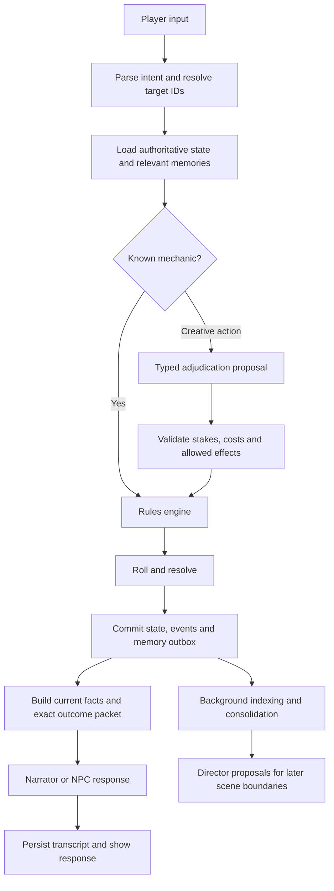

# Candlelight Quest: LLM and pipeline review

**Superseded recommendation:** the user subsequently prioritized local inference. See [the local-first implementation plan](local-first-implementation-plan-2026-09-10.md) for measured local results and the current recommendation. The source findings below remain supporting context.

Reviewed September 10, 2026 against the current working tree, including its uncommitted changes. This is a source review and current model research, not a live comparison of model outputs. The existing test suite passed: **1,679 tests in 2.96 seconds**. Additional isolated probes reproduced retrieval ordering, filtering, repeated embedding, and duplicate-indexing behavior. No gameplay code or configuration was changed.

**Recommendation:** retain the deterministic rules engine, fix the context and memory contracts, then use Claude Opus 5 as the initial premium narrator/NPC/Director baseline. Compare GPT-6 Astra and Claude Fable 5.1 for difficult adjudication and campaign planning. For economical play, try Sonnet 5 for prose with premium adjudication only when necessary. For local play, keep Qwen3.5-9B as the control and audition a roleplay fine-tune specifically for NPC dialogue.

No source reviewed establishes an absolute RPG winner across these current models. Model documentation establishes capabilities and availability; fine-tune cards describe training intentions; neither substitutes for a replay evaluation in this game. The model choices below are engineering recommendations to test.

**What the game actually needs**

This is a structured RPG with persistent entities, authored regions, quests, combat, crafting, factions, companions, and time travel. It needs several different abilities: understanding a player's intent, proposing bounded creative effects, producing appealing prose, portraying consistent NPCs, and selecting appropriate historical information. Those should have separate interfaces even when one model serves every role.

The strongest existing design is that dice and most mechanics live in Python. The creative-action path already proposes effects from a constrained menu, validates them, and derives descriptions from accepted effects. Extend that pattern. An attractive paragraph is not evidence that a door unlocked, an NPC agreed, or a reward was earned.

**Model shortlist**

| Candidate | Where I would try it | Main qualification |
| --- | --- | --- |
| Claude Opus 5 | Initial premium baseline for narration, NPC dialogue, and Director | A reasonable single-provider starting point; its general capability does not establish a roleplay win. |
| GPT-6 Astra | Difficult action interpretation, adjudication proposals, consistency checks; also compare prose | Official documentation emphasizes instruction following and multistep work. It requires reasoning and needs explicit prose style control. |
| Claude Fable 5.1 | Quality-ceiling challenger for difficult Director/planning work | Slower, always-on adaptive thinking. Evaluate its benefit on demanding scenes before placing it on every turn. |
| Claude Sonnet 5 | Economical everyday prose and structured tasks | Lower token cost; keep it in the same replay comparison rather than assuming the larger model always produces preferable dialogue. |
| Gemini 3.8 Flash | Latency challenger for classification, extraction, and narration | Current stable candidate in Google's catalog; adding it requires extending the game's provider/key setup. |
| Qwen3.5-9B | Existing local control, classification and bounded JSON proposals | Already configured here; measure actual runtime behavior before replacing it. |
| G4-Plainsong-12B | Local NPC dialogue specialist | Its author describes short, character-focused dialogue and RPG/persona training data. That matches the game's short exchanges, but it is an experimental candidate rather than a verified winner. |
| Qwen3.8-27B Humanlike Chat | Larger local conversational candidate | Author describes conversation adaptation; reasoning support is work in progress. The listed Q4 file alone is 16.55 GB. |
| Pantheon-RP-1.6-12b-Nemo / Euryale-v2.3-70B | Older RP-specific comparison points | Useful evidence that RP fine-tunes exist; their age and specialization mean they should not automatically outrank newer general models. |

Official sources: [Opus 5](https://www.anthropic.com/news/claude-opus-5), [GPT-6 Astra guidance](https://developers.openai.com/api/docs/guides/latest-model), [Fable 5.1](https://platform.claude.com/docs/en/models/fable-5-1/overview), [Claude model pricing](https://platform.claude.com/docs/en/about-claude/pricing), [Gemini model catalog](https://ai.google.dev/gemini-api/docs/models), [Qwen3.5-9B](https://huggingface.co/Qwen/Qwen3.5-9B). Specialist model cards: [Plainsong](https://huggingface.co/ewald1976/G4-Plainsong-12B), [Humanlike Chat](https://huggingface.co/LessThanThreeAI/Qwen3.8-27B-Humanlike-Chat-GGUF), [Pantheon](https://huggingface.co/Gryphe/Pantheon-RP-1.6-12b-Nemo), [Euryale](https://huggingface.co/Sao10K/L3.3-70B-Euryale-v2.3).

There are three useful configurations:

1. **Premium:** Opus 5 prose and NPCs; Opus initially for adjudication, with Astra/Fable evaluated as replacements for the hardest cases. Python handles rules. Separate role configuration permits changing one part without changing every NPC's voice.
2. **Practical hybrid:** Sonnet 5 prose; local Qwen for ambiguous-input classification or background extraction if it meets correctness and latency targets; premium Director only on difficult actions and important scene transitions. Measure whether local/cloud routing is actually better than Sonnet alone.
3. **Local:** one resident 9–12B model plus a small embedding model. Compare Qwen against Plainsong for dialogue using identical memory packets. On a memory-constrained Mac, repeatedly switching between two large local models could erase the performance benefit of specialization.

The configuration comment mentions an 18 GB machine, but hardware capacity was not verified. If 18 GB is the actual total, the 27B model's 16.55 GB weight file leaves insufficient comfortable headroom for the OS, runtime, context, and embeddings. Prefer 9–12B quantized models; consider 27B with substantially more memory. A 70B model is a different hardware class. Parameter count or an advertised context window does not tell you the usable context on your machine.

For scale, at 4,000 uncached input tokens and 250 billed output tokens per call, 100 narration calls would cost about **$1.05 on Sonnet 5, $2.63 on Opus 5, or $5.25 on Fable 5.1** at the reviewed rates. These are arithmetic illustrations, not measured game costs: classification, Director calls, retries, and additional reasoning output increase them; cache hits can reduce them. Current Sonnet pricing is $2/$10 per million input/output tokens, despite the older $3/$15 entry in this game's catalog. [Current Claude pricing](https://platform.claude.com/docs/en/about-claude/pricing).

**The RPG/memory models you may remember**

[PsyMem](https://aclanthology.org/2026.tacl-1.24/) is especially close to your description. Its authors train Qwen2.5-7B-Instruct using psychological attributes and explicit memory alignment for character portrayal. It reports improvements on its roleplaying evaluations, not on this game's rules, quest consistency, or current frontier-model comparisons. Treat it as a relevant research direction; I did not verify a ready-to-run checkpoint and runtime combination for this project.

Ordinary inference does not update a model's weights with your campaign. RP training can teach voice and how to use supplied memory, but the application must still persist experiences and retrieve them. A larger context window also does not decide which facts are true now, which were false rumors, or which belong to a previous timeline.

[Letta's persisted memory blocks](https://www.letta.com/blog/memory-blocks/) offer a useful pattern for compact character and campaign state. [Graphiti](https://help.getzep.com/graphiti/getting-started/welcome) offers temporal entities, relationships, and hybrid retrieval. [Generative Agents](https://arxiv.org/abs/2304.03442) provides evidence for combining observation, planning, and reflection. These are patterns to adapt; this game does not need a framework migration to get their main benefits. Start with SQLite tables, the existing event ledger, and a repairable retrieval index.

**Confirmed pipeline findings, in priority order**

| Priority | Finding and code evidence | Player impact / proposed correction |
| --- | --- | --- |
| P1 | NPC answers live only in `_active_conversation.history`; persistent NPC facts contain the player's input. See `turn_loop.py:728` and `social/system.py:340`. Initial greetings are generated before conversation initialization. | NPCs can forget what they themselves said after leaving or reloading. Persist both sides, including the first reply, with speaker, NPC, game, timeline, and turn IDs. |
| P1 | `Retriever.retrieve_relevant_lore` has no game filter. `retrieve_npc_history` accepts `game_id` but filters only by NPC/actor. Dialogue records the NPC as `target_id`, while event indexing does not retain that target. | Save-specific lore can mix; NPC event retrieval misses player-to-NPC interactions. Separate global lore from campaign facts and filter all campaign paths. Index participants, not only actors. |
| P1 | Events and indexed memories lack timeline/visibility distinctions. Rewind preserves historical events and vectors. | A previous-loop death or promise can be presented as current truth. Keep intentional player knowledge across loops but label its provenance; NPCs should know only what the game's rules allow them to know. |
| P1 | `process_turn` builds one context before dispatch, then supplies it to the Director and narrator after writes. | Movement, damage, newly generated content, and time changes can be paired with an old location or HP. Create an authoritative post-resolution snapshot and an explicit before/after result packet. |
| P1 | `EventLedgerRepo.get_recent` returns newest first, but `ContextPacker` takes `recent_events[-5:]`. | It selects the older five of the ten fetched events. Take the newest subset and present it chronologically. Reproduced in an isolated probe. |
| P1 | Repository calls commit individually; `_apply_mutations` catches failures per mutation. Event append failures do not stop vector indexing. | A partial turn can be described or remembered as fully completed. Use a transaction for accepted state, events, and an indexing outbox. Report only effects that committed. |
| P2 | The context packer defaults to 2,048 estimated tokens regardless of `num_ctx=8192`; trims from the end; leaves out active quests, inventory and companions in general narration. | Relevant history can be cut first. Pack by role and priority; reserve outcome facts and output space; include only relevant state, but guarantee critical facts survive. |
| P2 | One provider instance serves all roles. `[llm.narrator]`, `[llm.scene_planner]`, and root sampling limits are not wired into generation calls. `scene_plan.j2` has no active caller found; `director_interval` does not govern the current Director pass. | Configuration implies control it does not provide. Implement explicit role settings and remove or wire unused settings. |
| P2 | Three populated retrieval collections produce three embeddings of the same query; indexing is synchronous and uses fresh UUIDs. | Avoidable latency, duplicate memories on repeated indexing, and missing writes during outages. Embed the query once, batch writes, use stable event-derived IDs and upsert/replay. |
| P2 | Ollama structured calls explicitly bypass native schema enforcement. Several Director generators call structured generation without a schema. | JSON repair retries consume latency and may weaken contracts. Add a tested native Ollama schema path and typed outputs for every state-bearing proposal. |
| P2 | General narration is limited to 150/300 tokens, all failed actions bypass prose, and the narrator forbids questions or suggested actions while ambient hints are supplied. | These decisions constrain game feel regardless of model. Use scene-specific response budgets; narrate resolved failures; permit grounded choices when useful. |

The transaction issue is broader than wrapping `process_turn` in a context manager: repository methods currently commit the shared connection themselves, and some systems write while resolving. Introduce a unit-of-work boundary and gradually move those writes behind it. The general mutation validator also clamps HP against the player's maximum regardless of mutation target; use target-specific validation and legal field/type checks. Keep the stronger creative-effect validator.

Ollama documents native JSON-schema enforcement through its `format` field. That establishes a possible implementation path, not that the game's current LiteLLM/model combination supports it correctly. Verify the adapter and exact models with contract tests. [Ollama structured outputs](https://docs.ollama.com/capabilities/structured-outputs).

**A better turn pipeline**

Aim for one generation call on ordinary narration/dialogue turns. Use no model for explicit inventory, stat, and command operations where deterministic output is sufficient. Complex actions justify additional calls; do not add a planner, critic, summarizer, and NPC agent to every movement command.

For creative actions, the present post-roll effect proposal permits the model to choose consequences after seeing success. Consider proposing and validating the stakes and both success/failure effects first, then rolling and applying the selected branch. Keep costs, effect budgets and randomness in Python. Some situational details may still be generated after the roll, but cannot change the accepted stakes.

The narrator should receive intent, target IDs/names, exact accepted changes, current visible state, and relevant memory. Its words cannot create inventory or quest state. If an NPC proposes a promise, bargain, or task, pass that through a typed proposal/validation step; ordinary gossip can remain a sourced utterance rather than established world truth. Regex removal of a few quest phrases cannot enforce that distinction.

Move nonessential Director generation to a queue. Work from an immutable state version and validate proposals again before applying them at an appropriate scene boundary. Do not asynchronously mutate live state behind the narrator. Streaming improves perceived latency, but decide whether a scene's prose must be checked before displaying it; streaming alone does not guarantee factual consistency.

**Memory design to implement**

| Layer | Contents | Read strategy |
| --- | --- | --- |
| Authoritative state | HP, inventory, location, entities, quest terms and progress | Exact SQL lookups; never infer from prose |
| Recent interaction | Verbatim player and NPC turns, including first greeting | Last exchanges in chronological order |
| Durable facts | Promises, relationships, witnessed events, discoveries, unresolved obligations | Exact entity/topic lookup plus relevance ranking |
| Scene/campaign summaries | Current goal, unresolved threads, meaningful changes | Compact, bounded context blocks grounded in event IDs |
| Episodic archive | Full transcripts and events | Hybrid keyword/vector search when needed |

Attach `game_id`, `timeline_id`, `source_event_ids`, participants, subject, validity interval, visibility/knowers, and status to memory records. Separate an NPC's belief from an objective fact. Supersede an obsolete fact rather than silently concatenating contradictory versions. Summaries are derived data and should be reconstructible from committed records.

For example, an NPC's promise to keep a key is a sourced commitment; the actual key location comes from game state. After a rewind, the player may remember that promise from a prior loop, while the NPC has not yet made it. This distinction must be available before generation.

Combine exact IDs and keyword search for names, spells and quest objects with semantic search for paraphrases. Rank by relevance, recency, importance and unresolved status; prevent duplicate facts from filling the prompt. Retrieve using the player's current topic as well as the scene—searching only “NPC abc” or a generic action outcome loses the question being asked.

Keep nomic-embed-text as the baseline while repairing the retrieval logic. Evaluate [Qwen3-Embedding-0.6B](https://huggingface.co/Qwen/Qwen3-Embedding-0.6B) as an alternative; its small size makes it a plausible local candidate. A better embedding model cannot recover missing dialogue. Add a reranker only if a labeled retrieval test demonstrates sufficient benefit for the added latency. Detect actual vector dimensions rather than relying on the current hardcoded dimension tags when switching models.

**Implementation order and how to decide the winner**

1. Repair transcript persistence, event ordering, game/timeline isolation, participant indexing and post-action context. Add regression scenarios for leaving/re-entering a conversation, save/reload, movement, and rewind.
2. Establish transactional outcomes and a durable, idempotent indexing outbox. Test failures between state writes, ledger append, narration, and vector indexing.
3. Introduce role-specific model configuration, typed adjudication contracts, provider capability checks, and call telemetry: prompt/output/reasoning tokens, retries, finish reason, first-token and total latency.
4. Implement compact NPC/campaign memory, hybrid retrieval, and background consolidation. Derived memories must cite stored events; extraction failures must not overwrite authoritative state.
5. Run blind replay comparisons with identical snapshots, memory packets, token budgets and seeded dice. Compare models first on the same pipeline, then compare pipeline changes with a fixed model so the effects are distinguishable.

Use at least 50–100 authored situations spanning ordinary dialogue, unusual creative actions, failed rolls, quests, combat and travel, plus several 100+ turn campaigns with reloads and rewinds. Include an NPC promise recalled 40 turns later; a rumor contradicted by evidence; repeated names in different saves; a player claiming a reward that was never earned; an NPC with no knowledge of a private event; and a failed action that still deserves interesting prose.

Score mechanical contradictions, invented quest terms, recall accuracy, character voice, repetition, player agency, structured-output validity, latency, and actual total cost. Prefer blind human judgments for voice; automated judges can assist but should not be the sole authority. Log the exact model revision, quantization, runtime, prompt and sampler. Predeclare acceptable reliability and latency targets instead of optimizing only prose preference.

The next highest-value work is therefore the memory/context repair and replay harness. Model specialization is worth pursuing after those make an honest comparison possible.
