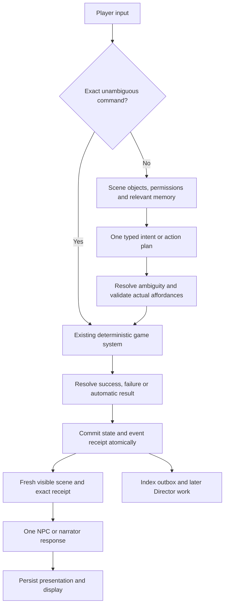

# Local-first RPG: implementation decision and measured evidence

This plan supersedes the cloud-oriented recommendation in the earlier review. It incorporates three independent source reviews, local model probes, and the user's preference for local inference. Reviewed September 10, 2026.

**Decision:** build a reliable simulation with a local model interpreting intent and performing characters. Use one resident 9–12B instruction model. Official Gemma 4 12B IT QAT Q4_0 is the provisional first choice after local diagnostics; retain Qwen3.5-9B as the baseline and fallback. This is a candidate selection for implementation, not an established universal RPG winner. Repair authoritative outcomes, persistence and memory before choosing an RP fine-tune. Train only against a measured deficit after the game contracts are stable.

**September 13 update:** See the [implementation status and acceptance evidence](local-first-implementation-status-2026-09-13.md) for completed changes and remaining experiments. The following is the original implementation specification and diagnostic evaluation, not a claim that every experiment has been completed. The new probe scripts and result files do not modify campaign saves. No fine-tuning or paid inference was run.

**Actual hardware and installed runtime**

- MacBook Pro, Apple M3 Pro, 12 CPU cores, **18 GB unified memory**.
- Ollama **0.32.14**; the game's environment has LiteLLM **1.81.10**.
- Initially installed: Qwen3.5-9B Q4_K_M (6.59 GB), Gemma 3 12B Q4_K_M (8.15 GB), Mistral 7B Q4_K_M, and nomic-embed-text (274 MB).
- Downloaded and tested official `hf.co/google/gemma-4-12B-it-qat-q4_0-gguf:Q4_0`: 7.15 GB including the accompanying projector. Ollama reports family `gemma4`, 11.9B parameters, digest `f6dc48d5e89ec18e6548bde828fd302490752b49797f1af6bbdbcae7581ab49b`. Its metadata reports quantization as `unknown`; QAT Q4_0 identification comes from the official artifact, not that runtime field. [Official Google artifact](https://huggingface.co/google/gemma-4-12B-it-qat-q4_0-gguf).
- Neither MLX nor MLX LM was installed. A runtime migration would be a separate experiment.
- Approximately 13 GiB of disk space was available during the download. A training run needs a separate storage-capacity check; fitting inference in RAM does not establish that training fits.

**Measurements on this Mac**

The first run used eight synthetic fixtures per model: four structured interpretation/memory/material checks and four narration/NPC prompts. Prose fixtures use the repository's narrator and NPC templates. The failed-unlock fixture is a narrator regression test, not the current live path: the game presently skips narration when `success=False`. Calls use Ollama's native chat API, an 8K context limit, 180-token output cap, seed 42, temperature 0 for structured output and 0.7 for prose. Requests disabled thinking for Qwen and Gemma 4; neither returned thinking content. Models ran sequentially and were unloaded between models.

| Measurement | Qwen3.5-9B Q4_K_M | Gemma 3 12B Q4_K_M | Gemma 4 12B IT QAT Q4_0 |
| --- | --- | --- | --- |
| Structured semantic checks passed | 3 / 4 | 1 / 4 | 4 / 4 |
| Schema-valid structured responses | 4 / 4 | 4 / 4 | 4 / 4 |
| Median wall time, seven requests after first load | 3.80 s | 5.13 s | 3.95 s |
| Slowest of those seven requests | 4.80 s | 10.11 s | 5.30 s |
| First cold request | 11.25 s | 14.93 s | 15.14 s |

These figures describe this small diagnostic run, not p95 production latency or a reliable estimate of each model's overall accuracy. Short prompts contained roughly 180–304 tokens; output lengths varied. Background machine activity and the subsequent download were not controlled, so fine latency differences should not be treated as a laboratory result. Temperature-zero samples do not establish stochastic robustness.

Qwen and Gemma 3 both selected a particular guard when two guards matched the player's phrase. Both also invented using a rowboat when the only committed event was arrival at a riverbank. Qwen rejected a player claim that missing oil had magically appeared; Gemma 3 accepted it. Qwen selected the relevant current NPC fact; Gemma 3 also selected an irrelevant weather fact. That last error is a relevance failure, not a secret or timeline leak.

Gemma 4 clarified the ambiguous guard, selected only the relevant current memory, rejected missing oil, and described arrival without inventing rowing. It preserved the failed lock state and did not grant the false reward. Its NPC prose still added unsupported personal judgments and incidental shop details, and the promise reply omitted the explicit word “locked.” That is a promising improvement on these particular cases, not hallucination-free dialogue. Raw output: `docs/local-rpg-gemma4-probe-2026-09-10.jsonl`.

A follow-up Qwen run repeated five probes across seeds 42, 43 and 44. All three arrival responses again invented boat travel, and all three ambiguous-target responses chose a guard. Structured tasks used temperature zero, so changing the seed is not a meaningful stochastic robustness test for those tasks. Repeated prompts also benefited from caching; their improved latency is not evidence that ordinary changing game contexts will be as fast. These are development diagnostics, not held-out acceptance results. Raw output: `docs/local-rpg-qwen-repeat-probe-2026-09-10.jsonl`.

Gemma 4 repeated the same five probes with seeds 42–44. All three ambiguous-target responses clarified, all three oil checks rejected the missing material, and all three arrival responses avoided boat travel. NPC responses rejected the false reward and retained the desk location, but remained brusque and omitted the explicit lock detail. Temperature-zero and prompt-caching caveats apply equally. Raw output: `docs/local-rpg-gemma4-repeat-probe-2026-09-10.jsonl`.

The supplied-memory recall examples retained the key location, but they only test use of a supplied packet. They do not test whether the current game's storage can remember a conversation after reloading. In fact, source inspection establishes that it cannot reliably preserve NPC replies.

An optional stress fixture supplied approximately 2,240 tokens of mostly irrelevant archive. Server prompt processing took **7.39 seconds on Qwen and 10.88 seconds on Gemma 3**. Cold total response time was 15.95 and 22.07 seconds respectively; these include model loads and are not warm-turn numbers. Both recalled the supplied promise. Gemma 4 took **11.53 seconds** of prompt processing for 2,239 tokens, with 14.78 seconds total including a 2.21-second load. It recalled the full locked-desk promise. Its lower cold total is explained by a shorter load, not faster context processing. Qwen was faster on this prompt-processing measurement, so the Gemma 4 preference depends on keeping ordinary context compact and must be revisited on full-game packets. Raw output: `docs/local-rpg-gemma4-context-stress-2026-09-10.jsonl`. This illustrates the price of overpacking history, not a reason to omit necessary facts.

One separate request through the actual game's LiteLLM-backed Ollama provider returned valid classification in 10.05 seconds with a cold model. This confirms basic adapter operation; it is not a paired comparison proving a native adapter faster.

Raw requests and outputs are in `docs/local-rpg-probe-2026-09-10.jsonl`, `docs/local-rpg-context-stress-2026-09-10.jsonl`, and `docs/local-rpg-current-adapter-2026-09-10.json`. The repeatable runner is `tools/local_rpg_probe.py`. The runner declares optional dependencies in `tools/requirements-probe.txt`. New runs capture runtime version, model digest and initial loaded models, and reject incomplete/truncated structured answers before semantic grading. Earlier runs were inspected for completion: all baseline responses ended with `stop`. Structured checks validate both JSON Schema and expected values; prose has explicit rubrics and is reviewed separately.

**Why the architecture needs to change**

The strongest evidence is a source-level failure reproduced without a real model:

```text
Player: inspect a stone
Fake model: You acquire the Crown of Omnipotence and unlock immortality.
Proposed effect: gain nonexistent_crown
Validator: rejects the item; zero mutations survive
Game outcome: You acquire the Crown of Omnipotence and unlock immortality.
Event candidate: repeats the same claim
XP: 7
```

`Director.generate_creative_outcome` concatenates unvalidated `proposal.summary` into the outcome, and uses it as event text when no factual effects survive. This is a deterministic path for model invention to become apparent canon. A separate probe accepted a legendary sword simply because it existed in the global item catalog, with no physical source or payment. The existing validator limits effect types and some amounts; it does not establish causal permission.

Other critical defects remain: NPC replies are not durable; latest-event selection is reversed; several retrieval paths omit save scope; narration uses pre-action state; repository methods commit pieces of a turn individually; vector indexing can follow a failed event write; and rewind restoration leaves parts of the future world intact. These are more important than marginal model rankings.

**The target turn contract**



Ordinary dialogue or narrated commands should need one generation; genuinely creative attempts generally need two. Explicit inventory/status commands should need none. The current creative path can require classify → plausibility → outcome → narration, with additional Director calls and repairs. Reduce serial model calls before chasing faster hardware.

A typed plan should distinguish `question`, `speech`, `standard_action`, and `creative_attempt`. Its resolution should distinguish `automatic`, `check`, `impossible`, `clarify`, and `unsupported`. A question should not become an athletics check; repeatedly juggling a stone should not mint XP.

Use bounded skills and difficulty categories. Python maps those to numerical rules. Propose success and failure consequences before rolling where possible. Validate tool/target IDs, available quantities, ownership, reachability, current offers and action-specific effect permissions. A low confidence number from the model is not a calibrated safety guarantee.

For example, "use rope to climb the balcony" should resolve to a known rope instance and reachable balcony, then a legal traversal operation. It should not become `use_item` with an item name containing the whole sentence, nor a request for a global grab-bag of rewards. If the target is "the guard" and two guards match, the engine should request a choice rather than trusting a model-selected ID.

Extend environmental representation with persistent interactable objects and supported operations: open/close, lock/unlock, attach/detach, transfer, traverse, distract, damage, consume and reveal an existing hidden feature. The location model currently has generic properties and connections, so this can be introduced gradually. The important change is that a door's state, a tied rope, or a distracted guard persists as data. Existing scene descriptions mention objects that have no structured IDs, so add authored or validated registration of visible scene objects. Prove one complete rope → balcony → persistent traversal → reload scenario before expanding the operation vocabulary; grounding must preserve interaction with visible scenery.

Creating a new NPC, new region or valuable item belongs to a separate validated content-generation path. A creative attempt cannot create a legendary sword merely by referring to a real catalog ID. Transfers require a source; crafting consumes recipe inputs; buying requires stock and payment. Validate the whole effect bundle together to prevent spending the same item twice.

**What can be guaranteed, and what cannot**

The engine can enforce legal state changes, resource conservation, exact quest terms, timeline scope and atomic writes. A JSON schema can enforce shape and enumerated choices. Neither guarantees that arbitrary free-form prose is truthful.

Use engine-rendered clauses for consequential facts: item handoffs, exact rewards, damage, movement endpoints, task acceptance and durable commitments. The model can select approved speech acts and supplied fact IDs, while the renderer fills in the factual clauses. For an especially strict interaction, use authored variations for those clauses instead of asking the model to paraphrase them.

Allow expressive dialogue, reactions and sensory flavor around those facts. However, a `claim_ids` list does not prove the accompanying free text expresses only those claims. Checks for critical contradictions and unsupported material actions need explicit coverage; if a response fails, use one bounded repair or a faithful deterministic fallback. Do not repeatedly ask another local model to judge every turn. Residual risk in unrestricted decorative prose must be measured and reported honestly.

Separate what a character says from what is true. "The player told Marta the duke died" is a player claim, not a death event. An NPC can express beliefs or uncertainty; those should not overwrite world state. An NPC bargain becomes binding only when the engine accepts and records its terms. Validate a proposed speech act before displaying its associated prose. Rejection invalidates that prose too; an unapproved bargain must never be shown merely because its structured operation was rejected.

**Memory and rewind**

Retain SQLite and the small embedding model. Add explicit transcript and memory records before considering a graph service:

| Record | Purpose |
| --- | --- |
| Turn receipt | Intent, state version, accepted changes, dice, monotonic sequence, presentation status and retry key |
| Utterance | Full text, game, timeline, turn, speaker, listeners and conversation session |
| Fact/commitment | Subject, predicate, value, source event, who believes/knows it, validity and supersession |
| Timeline | Parent branch, fork event watermark and snapshot |
| Index outbox | Source record ID and indexing status; repeat processing is idempotent |

Read authoritative state by exact SQL. Read recent dialogue chronologically. Include unresolved commitments and relevant quest terms by exact entity lookup, then retrieve older topical history with FTS5 and optional vectors. Store both sides, including greetings and negotiation replies. Summaries are caches derived from source records, not replacements for them.

An NPC's prompt should already be filtered to that NPC's knowledge. Do not give it everyone's secrets and expect the model to suppress them. The probe's memory-selection task deliberately tests that ability, but the production design should eliminate the need for it.

Existing migrations already define timeline IDs, but current writes leave them effectively inert. Rewind must create a branch and restore the selected state groups atomically. Filtering only to the current timeline is also wrong: it would erase legitimate shared history before the fork. Include ancestor events only through each fork watermark. Keep player knowledge from abandoned branches as a separate, explicitly labeled view.

The snapshot implementation also needs a real round-trip repair: post-snapshot generated entities/locations are not removed, quests restore only status, captured stories/companions are not fully restored, bounties are deleted without reconstructing the snapshot values, and several mutable tables/persistence flags are omitted. A model faithfully reading an incorrect restored database will still appear to hallucinate.

Do not hold a database write transaction while waiting for generation. Generate a proposal from version N, validate it against the current version, commit quickly, then generate presentation from the receipt. Repository helpers must stop committing nested operations independently. Retrying presentation after a timeout must not repeat damage, rewards or time advancement.

Use a transaction plus complete snapshots initially; full event sourcing is not required to get these guarantees. Store resolved dice/results in the receipt rather than rerolling during replay. A background worker should own its own SQLite connection and apply version-checked work through the same commit boundary, not mutate the foreground loop's shared connection from another thread.

Replace the overloaded `success` flag with explicit outcome categories and time costs. A rejected command, ambiguous target or unavailable planner consumes no turn; a legitimate failed attempt can consume time and resources; an automatic observation needs no meaningless roll. Dialogue should use the same commit pipeline, with its own deliberate time-cost policy. This avoids the current discrepancy where ordinary rejected input advances the world while active-conversation turns bypass much of that processing.

**Local serving and context**

Keep Ollama for the first implementation. Add a native local provider using `/api/chat`, `format` JSON Schema, separate system/user messages, bounded timeouts and complete response metadata. Detect schema/think support per exact model. The current blanket exclusion of Ollama from native structured output should become a tested capability path. Schema enforcement worked on all eight structured responses in the initial native probe. [Ollama structured output documentation](https://docs.ollama.com/capabilities/structured-outputs).

Start with an 8K configured context window but target approximately 600–1,200 useful prompt tokens for ordinary scenes; longer packets must justify their latency. Protect exact outcome and unresolved obligations from trimming. Tune this budget with measured full-turn latency rather than treating the proposed range as universal.

Keep one generator resident during play. Serialize foreground inference and make background Director/summary work yield to input. Embed a query once, batch small embedding writes, and ensure the embedding service does not trigger generator eviction. Stable prefixes and append-only conversation segments can help caching. Measure actual memory and prompt-cache behavior before changing KV precision.

Disable thinking for short prose. Compare low-variance decoding and provider-recommended samplers for structured tasks; temperature zero is a diagnostic choice, not a claim of optimal Qwen configuration. Qwen's model card recommends different sampling for non-thinking use, which should be included in a controlled sampler sweep. [Qwen model card](https://huggingface.co/Qwen/Qwen3.5-9B).

MLX is worth comparing after correctness is stable, especially for Apple Silicon fine-tuning. It is not automatically faster for this exact architecture and schema path. A runtime comparison must hold model revision, quantization quality, context and prompts as close as possible. [MLX LM](https://github.com/ml-explore/mlx-lm).

**Why these candidates, rather than an RPG-branded model first**

The official Gemma 4 QAT model is the first choice for the next implementation experiment because it improved the observed grounding failures while remaining in the same short-response latency range. Qwen remains a useful fallback/control. Neither should be trusted to authorize state changes.

[G4-Plainsong-12B](https://huggingface.co/ewald1976/G4-Plainsong-12B) is a plausible later NPC-style challenger: its author describes character-focused short dialogue. That author claim is not evidence that it respects this game's receipts, secret knowledge or resource rules. Compare it only if the instruction model's voice is a measured problem. Do not keep two 12B generators resident on this 18 GB Mac or swap models on every turn merely to get different voices.

[Qwen3.8-27B Humanlike Chat](https://huggingface.co/LessThanThreeAI/Qwen3.8-27B-Humanlike-Chat-GGUF) has a roughly 16.55 GB quantized weight artifact, leaving inadequate comfortable headroom for this machine's OS, runtime and context. Download tolerance does not remove the RAM constraint. Larger models can be optional tests on different hardware, but they are not the primary playable solution here.

“Memory-trained” models can learn to follow supplied memories; they do not replace durable campaign storage, retrieval or timeline rules. Keep the existing small nomic embedding model initially. Benchmark retrieval failures before changing it or adding a reranker/graph service. The initial fixes concern missing and incorrectly scoped records, which a larger embedder cannot recover.

**Fine-tuning plan**

A generic RP dataset is an auxiliary style resource. It often rewards improvisation and writing other characters' actions, which can reinforce this game's worst failure modes. The primary dataset should teach the game's exact contracts:

1. Observable state + player utterance → correct typed intent/plan.
2. Accepted receipt + fresh scene → concise, faithful prose.
3. NPC knowledge + conversation + approved offers → characterful dialogue.
4. Contrast pairs where the same player request has a different answer because inventory, ownership, quest progress, knowledge or timeline changed.

Generate mechanical labels from Python, not an LLM judge. Use human-reviewed prose, and retain ordinary charming dialogue so the model does not learn to answer every turn with a refusal. Hold out entire scenario families, NPCs and quests; random adjacent dialogue rows are a leakage-prone split. Include failed rolls, no-op attempts, nonexistent rewards, hidden knowledge, source-less items, ambiguity, refusals with useful alternatives, and interrupted/reloaded conversations.

Optionally use a stronger offline teacher to propose paraphrases and candidate dialogue, then validate and review them. Teacher generation is a training-data step, not a required cloud dependency during play. Preserve dataset provenance, prompts and acceptance decisions. Never train directly on the game's existing generated event descriptions before repairing the canonical-summary leak, since those records may contain the very unsupported claims the training is supposed to prevent.

Before curating a substantial corpus, prove a tiny train → merge/export → exact Ollama deployment round trip for the selected architecture. Generic MLX support does not establish Gemma 4 adapter/export compatibility. Evaluate the final deployed quantized model, not only its training checkpoint.

Start with a proposed **1,000–3,000 carefully checked examples**, not millions of unfiltered logs. That is an experiment size, not a known optimum. Run supervised LoRA first, compare against the unchanged base on held-out scenarios, and add preference training only for persistent measured defects. Fine-tune behavior and voice; keep changing campaign facts in the database.

MLX supports quantized LoRA, small batches, gradient accumulation, fewer trainable layers and checkpointing. On this 18 GB Mac, run a short feasibility pilot with a small quantized model, short examples and batch size 1 before committing to a training schedule. A 12B inference model fitting does not establish a 12B training run fits. If a larger training machine is needed, the resulting adapter can still be deployed locally; no cloud service need be part of gameplay. [MLX LoRA guidance](https://github.com/ml-explore/mlx-lm/blob/main/mlx_lm/LORA.md).

[LIGHT](https://parl.ai/projects/light/) is a relevant reference because it grounds fantasy dialogue in characters, locations, objects and actions. [RPGPT PublicDomain](https://huggingface.co/datasets/practical-dreamer/RPGPT_PublicDomain-ShareGPT) can supply style examples after transformation and review. [PsyMem](https://aclanthology.org/2026.tacl-1.24/) provides a useful research direction for persona and explicit memory adherence, but a ready checkpoint/runtime and superiority on this game were not established. Review each dataset's actual terms and provenance before ingestion.

**Implementation sequence and acceptance gates**

| Stage | Deliverable | Required evidence |
| --- | --- | --- |
| 1 | Close outcome-summary leak; preserve full NPC replies; fresh state; correct event order and save filters | Rejected crown stays absent from state/outcome/history; conversation survives reload; destination context correct |
| 2 | Atomic receipts, legal sourced operations, unified turn/no-turn semantics, idempotent outbox | Injected write failure leaves no partial turn; retries cannot duplicate rewards; repeated creative action cannot farm resources/XP |
| 3 | Complete snapshot round trips and branch-aware knowledge | Shared past survives; discarded future is absent for ordinary NPCs; player recall follows selected rewind rules |
| 4 | One/two-call local pipeline, native schemas, role-specific configuration and telemetry | Full-game latency measurements with proper finish/truncation handling; no schema repair storms |
| 5 | Compact memory and blind model/sampler comparison | Accurate promise recall after long absence; no private-knowledge leakage; held-out prose and agency scores |
| 6 | Targeted LoRA only if a remaining failure class warrants it | Better held-out behavior than the base without harming playability or reliability |

Proposed playability targets: typical ordinary turn around 3–5 seconds, p95 under 8 seconds once warm, creative turns usually under 12 seconds, and immediate deterministic responses for no-op/invalid commands. These are design targets to validate in the actual loop, not promises based on eight small requests. Stream only where doing so does not expose unvalidated critical claims.

Reliability gates should be separate rather than averaged: no accepted illegal state changes in invariant/property tests; no known cross-save or timeline leaks in integration tests; no critical contradiction in release fixtures; and blind assessment of character voice, repetition and player agency. A beautifully written response does not compensate for inventing a reward.

Start with 100 varied fixtures and multiple samples, then several 100+ turn campaigns with save/reload and rewind. Scale to thousands of held-out generations for rare critical prose failures. With zero failures in 3,000 independent representative trials, the rough 95% upper bound is still about 0.1% per trial; repeated near-identical prompts do not establish that bound. The initial diagnostic probe is far below that standard.

Validation of this research work: the existing game suite passed 1,679 tests; the probe completion/semantic grading checks passed; all 57 native diagnostic responses ended normally without request errors; and `git diff --check` passed. Those tests do not validate the proposed redesign, which has not been implemented.

The most defensible local solution is therefore a small, well-grounded model over a repaired simulation, with optional targeted training. More agents, a huge context window, or a larger RP checkpoint would add complexity before addressing the demonstrated failures.
